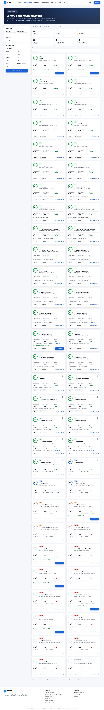
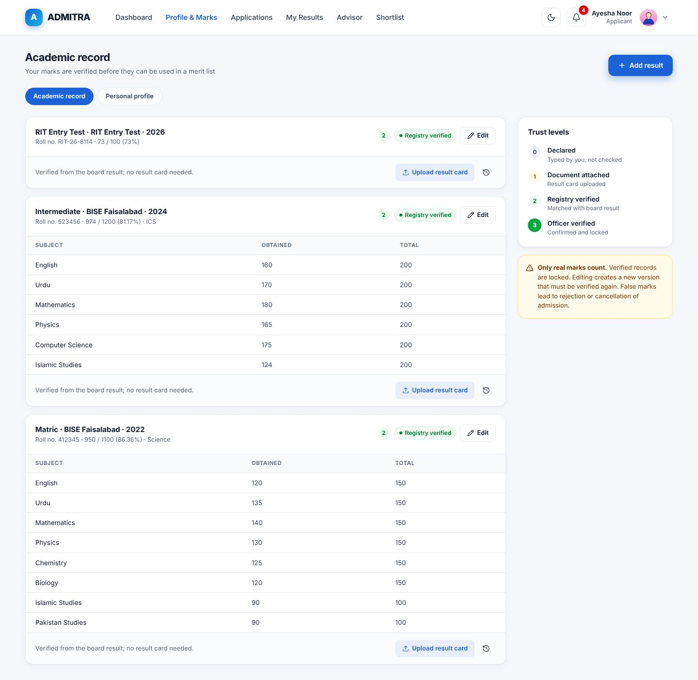
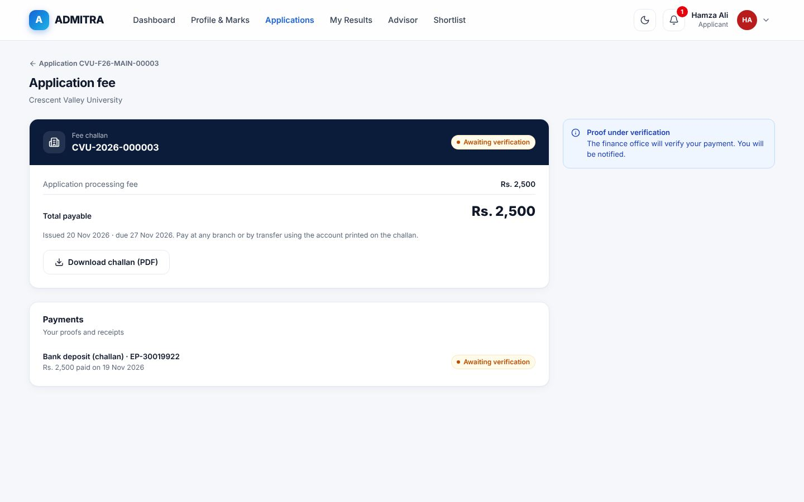
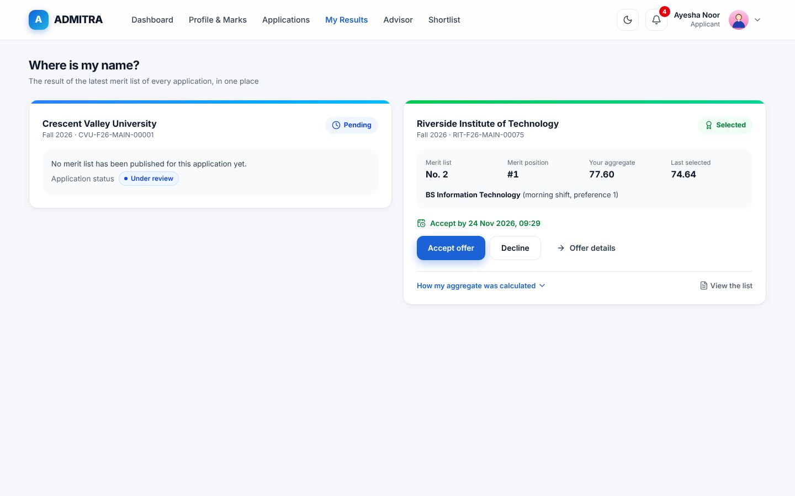

# ADMITRA – Applicant Manual

For students who apply to colleges and universities through ADMITRA. One account and one profile are
used for every institution. Screenshots are in `docs/screenshots` (`desktop/` and `mobile/`); the
pictures below are from the demonstration data.

## 1. Without an account

| Page (top menu) | What you can do |
| --- | --- |
| **Home** | Search a program or institution and see the open admission campaigns. |
| **Admission Advisor** | Enter your Matric %, Intermediate % and (optional) entry test % and press **Show my chances**. Every program gets a chance (Safe, Target, Reach or Unlikely) worked out from up to three years of closing merit. Open a program to see how the chance was calculated and try other test marks (what-if). |
| **Directory** | All colleges and universities with their programs, fees and closing merit history, also those that are not on ADMITRA. Tick programs to compare them side by side. |
| **Open Programs** | Programs whose admission campaign is open, with eligibility, seats and fees; **Apply now** starts an application. |
| **Merit Lists** | Published merit lists. Names are shortened and CNIC numbers are never shown. Search a list or download its PDF. |
| **Check Status** | Application number + last four digits of your CNIC / B-Form + the answer of the security sum → the status of the application only. Sign in to see more. |

## 2. Create an account

**Log in → New to ADMITRA? Create an applicant account.** Enter your full name as written on your
CNIC / B-Form, your e-mail and a password with at least 8 characters, an upper-case letter, a
lower-case letter and a digit. Open the verification link that is e-mailed to you, then log in.
Forgot your password? Use **Forgot password?** on the login page; the link works once and for 30 minutes.
After five wrong passwords the account is locked for 15 minutes.

## 3. Profile & Marks

**Personal profile** – personal information, guardian and address. The CNIC / B-Form number has 13
digits (dashes are optional). Press **Save profile**. **Download my data** gives you everything ADMITRA
stores about you; **Delete account** is possible while no application has been submitted.

**Academic record** – press **Add result** for Matric, Intermediate, Bachelor's, Master's or an entry
test. Enter the board, roll number, year, group and the marks of every subject. The total and the
percentage are calculated by ADMITRA; subject marks must add up and can never be higher than the total.

Each result shows its **trust level**:

| Level | Meaning |
| --- | --- |
| 0 – Declared | Typed by you, not yet checked |
| 1 – Document | You uploaded the result card (DMC) |
| 2 – Registry verified | Matched automatically with the official board result |
| 3 – Officer verified | Checked by an admission officer |

Only marks at level 2 or higher are used in merit lists (the institution can set the minimum). If your
roll number is not in the registry yet, press **Upload result card** so that an officer can check it.
Editing a verified result creates a new version that has to be verified again.

## 4. Apply

1. Choose a program (Open Programs, Directory or Admission Advisor) and press **Apply now**.
2. The application has four steps: **Programs** (choose up to the allowed number of programs and
   shifts in order of preference), **Eligibility** (ADMITRA shows for every program whether you meet the
   minimum marks and groups, and why not), **Documents** (upload every required document as PDF, JPG
   or PNG within the size shown) and **Review & submit**.
3. **Submit application**. If something is missing, ADMITRA lists every missing item. After submission
   you get an application number (for example `CVU-F26-MAIN-00001`) and a fee challan; documents can no
   longer be changed.

Only one active application per admission campaign is allowed. An application can be withdrawn
(**Withdraw**) until an offer is issued.

## 5. Pay the application fee

Open the application and press **Pay fee**. Download the challan (**Download challan (PDF)**), pay
at the bank or by transfer, then fill in the payment method, the transaction reference, the amount and
the date, attach the proof and press **Submit proof**. The finance office verifies it; you get a
notification and a receipt (PDF). A reference number can be used only once.

## 6. Follow your application

**Applications** shows the status and a timeline of every application. The admission office checks
the fee, your documents and your eligibility. If something is wrong you receive a **deficiency notice**
with the reason; correct it and resubmit. Every step also arrives as a notification (bell icon) and
by e-mail.

## 7. My Results and offers

**My Results** shows, for every application, the outcome of the latest published merit list:
Selected, Waiting list, Not selected or Pending.

- **Selected**: list number, merit position, your aggregate, the last selected aggregate, the program
  and shift and the deadline. **Accept offer** or **Decline** (declining asks for confirmation).
- **Waiting list**: your waiting position and an estimate of your chance in the next list.
- **Not selected**: how many marks you were below the last selected aggregate, with other programs
  suggested by the Admission Advisor.

**How my aggregate was calculated** shows every component with its percentage, weight and contribution.

After accepting, open **Offer details**: pay the admission fee, wait for the finance office, and receive
your **registration number** and **admission letter (PDF)**. Some institutions also check your original
documents on the reporting day.

## 8. Advisor and shortlist

In the signed-in **Advisor** the saved, verified marks are used automatically (they are labelled as
verified or self-declared). **Save to shortlist** keeps a program on your **Shortlist**, where you can
compare programs and download the shortlist as a PDF.

## 9. Account settings

The menu under your name opens **Account settings**: add or remove a **profile picture** (PNG, JPG or
WebP up to 2 MB), change your name and password and choose the light or dark theme. Without a picture
your initials are shown.
