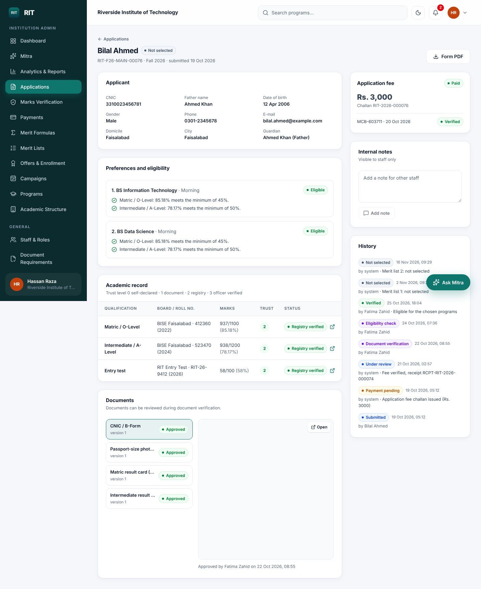
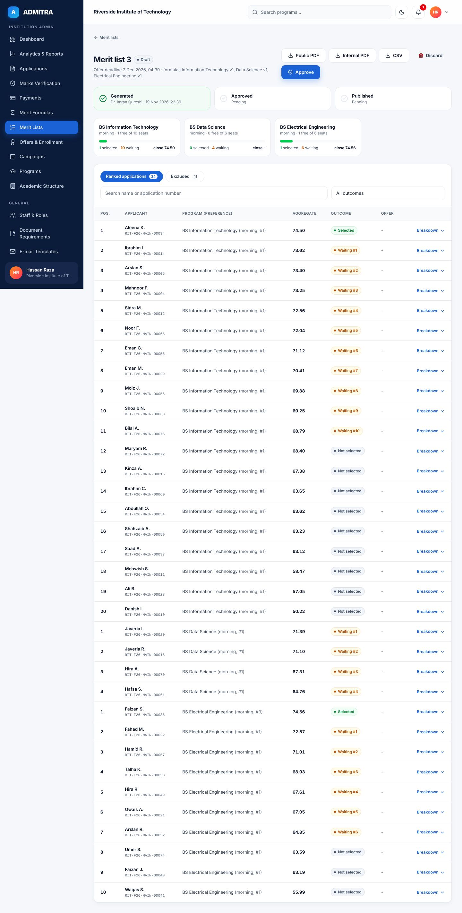
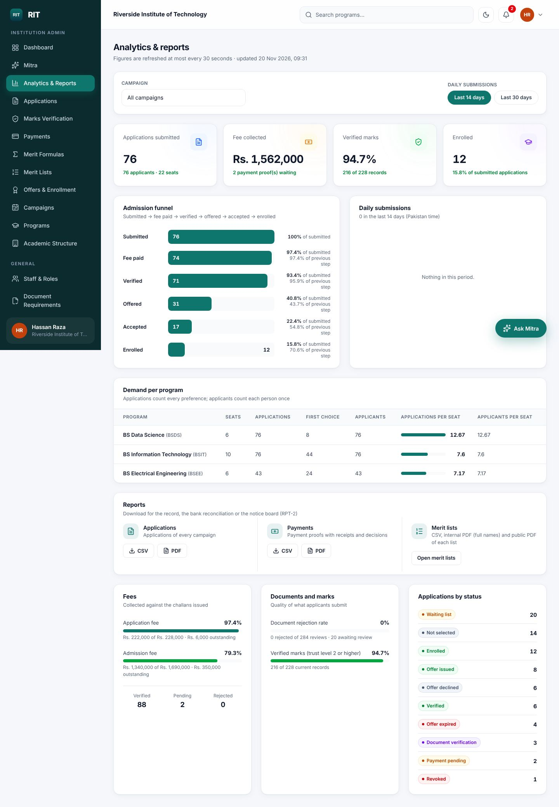
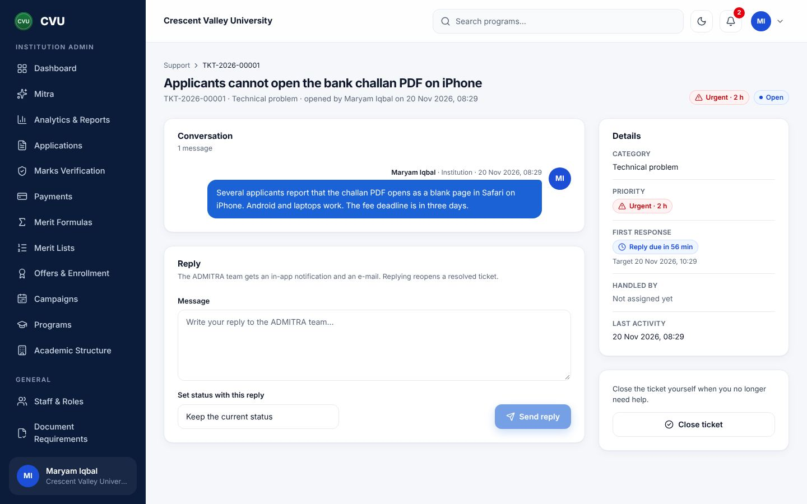

# ADMITRA – Institution Workspace Manual

For the staff of a college or university: Institution Admin, Admission Officer, HOD Officer, Finance
Officer and Merit Committee. Each person only sees the menu items of his or her roles.

| Role | Menu items |
| --- | --- |
| Institution Admin | Everything below, including Staff & Roles, Settings, Support and Audit Log; publishes merit lists |
| Admission Officer | Dashboard, Applications, Marks Verification, Offers & Enrollment, structure (view) |
| HOD Officer | As Admission Officer, but only the applications of his or her departments |
| Finance Officer | Dashboard, Payments, Offers & Enrollment, Analytics & Reports |
| Merit Committee | Dashboard, Merit Formulas, Merit Lists, Offers & Enrollment |

Staff accounts are created only by invitation (**Staff & Roles → Invite staff**). The invited person opens
the e-mail link (valid for 7 days), chooses a password and lands in the workspace. A person who works for
more than one institution chooses the workspace in the menu under his or her name.

## 1. Set up (Institution Admin)

1. **Settings** – tabs **Profile** (public profile, website, e-mail, phone, address, about), **Bank
   account** (printed on challans), **Branding**, **Workflow**, **Entry-test results** and **Subscription**.
   On plans with custom branding the **Branding** tab uploads your logo (shown in the sidebar and on your
   public pages) and sets your primary and sidebar colours. A preview shows the result; colours are
   adjusted automatically so that text stays readable. **Platform colour** goes back to the default.
2. **Academic Structure** – campuses, faculties, departments and academic sessions (one is current).
3. **Programs → Add program** – title, code, degree level, department, campus, duration, shifts with
   seats, eligibility rules (qualification, minimum %, groups, subjects), entry test and fees. A program
   used by a campaign is archived instead of deleted.
4. **Document Requirements** – the documents applicants upload: formats (PDF, JPG, PNG), maximum size,
   required or optional and the degree levels they apply to.
5. **E-mail Templates** – change the wording of every e-mail (submission, payments, deficiency, marks,
   verification, offers, waiting list, results, enrollment, expiry, revocation). Click a variable such as
   `{{applicantName}}` to insert it; **Default text** restores the original.
6. **Campaigns → New campaign** – title, code (used in application numbers), session, opening and
   closing time, programs (with an optional seat cap) and the rules: maximum preferences, duplicate and
   late applications, application fee policy and the minimum marks trust level for merit. Status changes:
   Draft → Open → Closed → Open again or Archived. Open campaigns close automatically at the closing time.

## 2. Applications (Admission Officer, HOD Officer)

**Applications** lists submitted applications with filters for status, campaign, program, department
and marks state (verified, pending, mismatch, fraud flag). Open one to see the applicant, the preferences
with eligibility, the documents, the marks, the payment, the timeline and internal notes (never shown to
the applicant). The actions follow the workflow:

1. **Start document verification** – only after the finance office verified the fee.
2. Review each document (approve or reject with a reason).
3. **Send deficiency notice** with a written note when something must be corrected; the applicant
   resubmits.
4. **Documents verified** – only when every required document is approved.
5. **Mark verified** – only when the marks are verified (trust level 2 or higher); or **Reject
   application** with a note.

**Form PDF** prints the application form.

## 3. Marks Verification (Admission Officer)

Records that are not in the board result registry, or that differ from it, wait here. The panel shows
the entered marks next to the registry result, the integrity checks, the uploaded result card and the
history. **Confirm verified** (trust level 3) or **Flag mismatch**, always with a note. Every decision
goes to the audit log with your name, the time and the IP address. Fraud flags (the same roll number or
result card used by two applicants, repeated mismatches) are shown with the record.

## 4. Payments (Finance Officer)

**Payments** shows proofs of payment awaiting verification with checks (amount matches the challan,
reference used only once). Open a proof, compare it with the bank statement, then **Verify** (a receipt
number and PDF are issued) or reject with a reason. Each payment can be decided only once. **Export
CSV** gives the list for reconciliation. Admission-fee payments of accepted offers are verified here as well.

## 5. Merit (Merit Committee and Institution Admin)

**Merit Formulas** – one versioned formula per program and campaign: components (Matric, Intermediate,
entry test, …) with weights that total 100%, optional minimums and tie-breakers. **Test the formula**
shows the aggregate for sample marks line by line. An active version is locked; changes are made in a
new version.

**Merit Lists**

1. **Generate** a list with the offer deadline. ADMITRA ranks every verified application with the
   active formulas and allocates seats by preference without exceeding the seats of any program and
   shift. Applications that cannot be ranked are listed with the reason.
2. A **second** committee member opens the list and presses **Approve** (four-eyes rule).
3. The Institution Admin presses **Publish merit list**. Offers, notifications and e-mails are created in
   one transaction; the list appears on the public Merit Lists page with shortened names.
4. A published list is never changed silently: **Revise published list** creates a new revision.
   A draft can be discarded with a reason.

Downloads: **Public PDF** (shortened names, no CNIC), **Internal PDF** (full names) and **CSV**.

**Offers & Enrollment** – seats, offers, acceptances and enrollments per program and shift. Offers expire
automatically at the deadline and the seats go to the next list. When the institution checks originals
on the reporting day, confirm the originals here; the registration number and admission letter are then
issued. **Revoke admission** needs a written reason and can block the CNIC for this admission cycle.

## 6. Analytics & Reports

**Analytics & Reports** (Institution Admin, Finance Officer) shows, for one or all campaigns:

- the admission funnel: submitted → fee paid → verified → offered → accepted → enrolled, with the share of
  submitted applications and of the previous step;
- daily submissions for the last 14 or 30 days;
- applications and applicants per seat for every program;
- application and admission fees collected and outstanding, and payment proofs verified, pending and rejected;
- the document rejection rate and the share of verified marks;
- applications by status.

Figures are refreshed at most every 30 seconds. **Reports** downloads applications and payments as CSV or
PDF; merit lists are exported from the merit list page.

## 7. Directory Data

Keep the public profile and the programs of the reference directory up to date and add closing merit of
earlier years (one by one or **Import past lists** from CSV, always with the official source). New rows
are verified by the platform team. When a list is published on ADMITRA its closing merit is added
automatically. **Claim an old listing** links an older directory entry to your institution.

## 8. Support (Institution Admin)

**Support → New ticket**: subject, category (technical problem, billing and plan, account and access, data
correction, feature request, other), priority and a message. The priority sets the first-response target:
Urgent 2 hours, High 8 hours, Normal 24 hours, Low 72 hours. The ADMITRA team is notified at once.
Replies appear as a conversation; every reply notifies the other side by notification and e-mail.
Statuses: Open, In progress, Waiting on institution, Resolved, Closed. Replying to a resolved ticket reopens
it; **Close ticket** when everything works. Only your institution can see its tickets.

## 9. Mitra, the admission copilot (Institution Admin)

On the Enterprise plan the **Mitra** menu item and the **Ask Mitra** button (bottom right of every page)
open the assistant. Ask in English, Urdu or Roman Urdu, for example "How many applications did we receive
today?", "Which payments wait for verification?" or "How many seats are still free?". Mitra answers from
your institution's live data only and shows each step it takes ("Reviewing payments…").

Mitra is friendly: you can greet it ("Hi", "Assalam o Alaikum", "kaise ho?") and it answers warmly.
If you write in Roman Urdu (for example "aaj kitni payments pending hain?") it answers in Roman Urdu;
otherwise it answers in English.

Mitra can prepare work for you: reminders for unpaid challans, offers that expire soon and unfinished
applications, opening a support ticket or closing a reviewed alert. A card shows exactly what will happen;
nothing is sent until you press **Confirm** (or **Cancel**). Confirmed actions are recorded in the audit log.

- **Briefing** – every morning a short summary of the last 24 hours (applications, payments, enrollments,
  pending work, free seats, alerts) arrives as a notification and an e-mail. **Refresh** makes one now.
  The Standard plan includes the briefing without the chat.
- **Integrity alerts** – patterns that need a human look (for example a payment verified below the challan
  amount or marks confirmed although the board registry differs), each with its evidence. Mark an alert as
  reviewed or dismiss it with a note. Alerts are not proof of wrongdoing.

Each person can send up to 200 messages a day.

## 10. Audit Log (Institution Admin)

Every important action of your institution: who, what, when and from which IP address. Search, filter by
action, record type and dates, open an entry to see the recorded details, or **Export CSV**.
