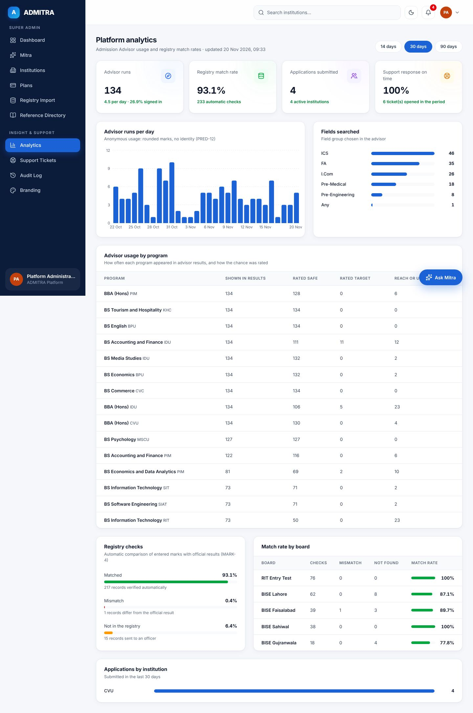

# ADMITRA – Super Admin Manual

For the ADMITRA platform team. The first Super Admin is created by the protected seed command
(`npm run seed`) with the e-mail and password from `.env`.

## 1. Dashboard

Active, pending and suspended institutions, programs, open campaigns, applicants and staff, onboarding
requests waiting for approval, subscriptions ending soon, institutions per plan and recent activity from
the audit log.

## 2. Institutions and plans

- **Institutions** – requests from the public form **Register your institution** arrive as *Pending*.
  Open one to **Approve** it with a plan and trial days (an invitation is e-mailed to the contact person,
  who becomes the Institution Admin) or **Reject** it with a reason. Active institutions can be suspended
  (staff are blocked at once and the institution disappears from public pages) and re-activated, and their
  subscription renewed. An expired subscription gives a 7-day grace period, then the workspace becomes
  read-only; nothing is deleted.
- **Add institution** creates an institution directly.
- **Plans** – price, trial days, limits (campuses, programs, staff, applications per cycle) and features.

## 3. Registry Import

Upload the official board results (CSV or Excel, **Download template** for the columns). **Check file**
shows a preview with every row error; only valid rows are imported. Waiting academic records are checked
again automatically. A batch can be rolled back within 7 days (**Roll back**); records verified by it
return to their previous state. Registry rows are never visible to applicants or institution staff.

## 4. Reference Directory

The verification queue of merit history entered by institutions or imported, institutions and programs
of the directory (also those not on ADMITRA), imports, the data-gap report (programs without data for
the current year), claims by institutions and the Admission Advisor usage.

## 5. Analytics

**Analytics** (14, 30 or 90 days):

- Admission Advisor runs per day, share of signed-in users, fields searched and **usage by program**
  (how often a program appeared in advisor results and how the chance was rated);
- **registry match rates**: matched, mismatch and not in the registry, overall and per board;
- applications submitted per institution and the share of support tickets answered within their target.

## 6. Support Tickets

Tickets of every institution with counts per status and the number with an overdue first response
(filter **Only tickets with an overdue first response**). Open a ticket to read the conversation, **Assign
to me**, change the priority (the response target moves with it) or the status, and reply. A reply can
set the status at the same time (In progress, Waiting on institution, Resolved, Closed); an open ticket
moves to *In progress* with the first reply. The institution admins are notified in the app and by e-mail.

## 7. Audit Log

Every recorded action on the platform with the person, institution, record, time and IP address. Search,
filter by action, record type and dates, open an entry for the recorded details or **Export CSV**.

## 8. Branding

**Branding** changes the platform name, tagline, the name of the AI assistant, the logo, the favicon and
the primary, sidebar and initials colours. Any colour can be chosen; it is adjusted only as much as
needed to keep text readable (WCAG AA) and the preview shows the result. **Save branding** applies it to
every page, e-mail and PDF within 30 seconds; **Default colours** restores the original colours.
Institutions on plans with custom branding can use their own logo and colours in their workspace.

## 9. Mitra, the admission copilot

**Mitra** (also the **Ask Mitra** button on every page) answers questions about the whole platform from
live data: today's applicants and applications, payments, enrollments, institutions, subscriptions and
platform fees, support tickets, staff activity, the audit log, advisor usage and registry match rates.
It can prepare renewal reminders for institutions, replies to support tickets and closing of reviewed
alerts; nothing happens until you press **Confirm**.
Mitra answers greetings and small talk in a friendly way and replies in Roman Urdu when you write
Roman Urdu (for example "Assalam o Alaikum, aaj kitni applications aayi hain?"), otherwise in English.

- **Briefing** – every morning: new applicants and applications, payments, enrollments, platform fees,
  subscriptions ending within 30 days or in the grace period, waiting payment proofs, open tickets and
  integrity alerts; delivered as a notification and an e-mail.
- **Integrity alerts** – rule-based findings with evidence across all institutions (bulk or overridden
  marks verifications, payments below the challan, stale payment proofs and fraud flags, repeated list
  revisions, revocation spikes, sensitive actions at night, offers above capacity, late applications).
- **Platform fees** – when renewing a subscription (Institutions → institution → Renew) enter the fee
  received, the method and the reference; empty means plan price × months. Mitra reports these payments.
- The AI provider is set in the backend `.env` (see the Installation and Operation Manual). The chat header
  shows the provider and model in use.

Plans decide what institutions get: Standard has the daily briefing, Enterprise also the chat and actions.

## 10. API documentation and backups

See the Installation and Operation Manual: Swagger UI at `/api/v1/docs`, daily backups with
`npm run backup` (kept 14 days) and `npm run restore`.
